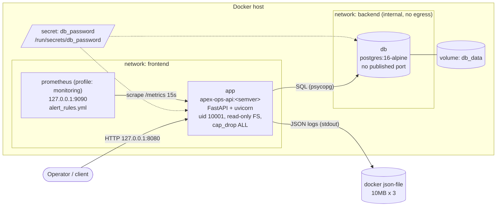
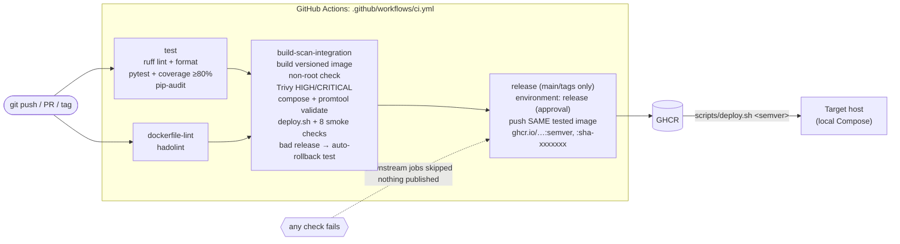
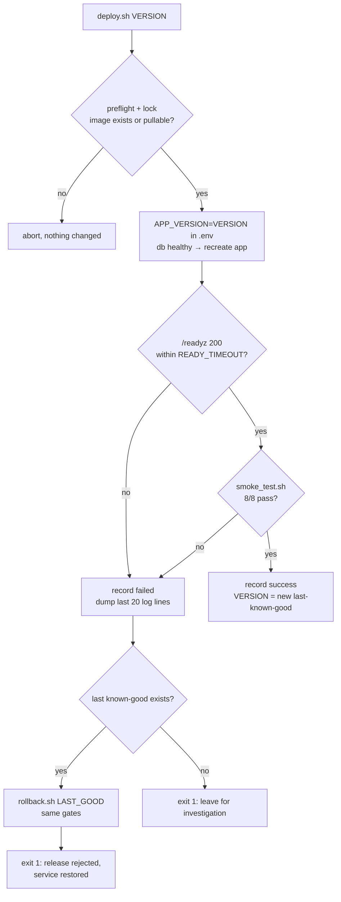

# Architecture

## Runtime (local, Docker Compose)



- **app**: the Apex Operations API. `/healthz` and `/readyz` probes, `/metrics`, `/version`, and `/api/v1/incidents` CRUD (create, list, get).
- **db**: PostgreSQL 16. Data lives on the named volume `db_data` and survives container recreation (shown in evidence 07 and 09).
- **prometheus**: optional. Scrapes the app and evaluates four alert rules.

## Commit-to-release pipeline



`scripts/ci_local.sh` runs the same gates locally in Docker, so a contributor can reproduce CI without GitHub.

## Release / rollback flow (`scripts/deploy.sh`)



## Repository layout

```
app/                 FastAPI service (config, db, logging, metrics, main)
tests/               17 unit tests + 1 intentional failure (pytest, SQLite)
Dockerfile           multi-stage: builder → dev (tests) → runtime (non-root)
docker-compose.yml   app + postgres (+ prometheus profile), secrets, volumes, networks
.github/workflows/   CI/CD pipeline;  .github/dependabot.yml
monitoring/          prometheus.yml, alert_rules.yml
scripts/             build, deploy, rollback, smoke_test, ci_local, incident_drill, init_secrets
docs/                runbook, decision memo, security, observability, cloud path, AI disclosure, evidence/
```
